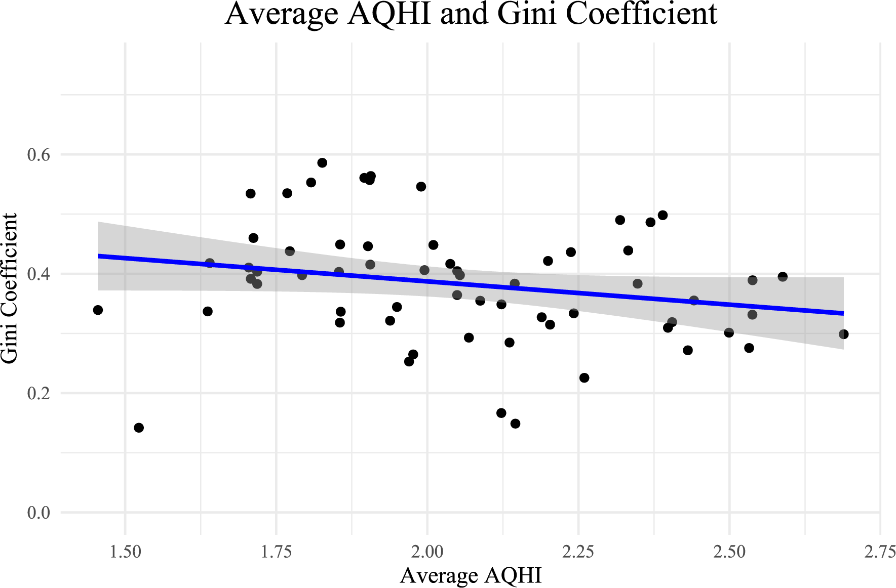
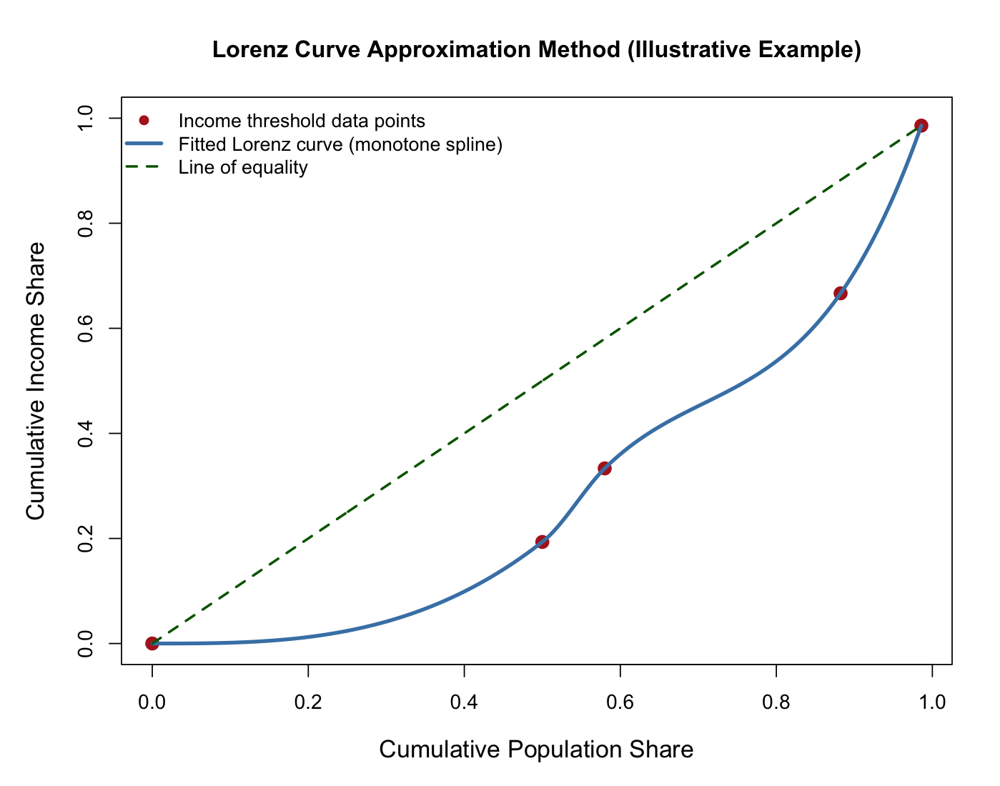

# Air Quality and Income Inequality: Canadian Metropolitan Areas

This paper was presented at the London School of Economic's Knowledge Beyond Boundaries interdisciplinary research conference (Jun 2025)

[Read the full paper (PDF)](Code/AirQualityIncomeInequality.pdf) · [Play with the interactive 3D map](https://krishaant.github.io/ECON326_FinalProject/)

## Overview

We test: is air pollution associated with higher income inequality within Canadian Metropolitan Areas (CMAs)?

Prior literature finds that stringent air quality regulation is associated with *higher* income inequality, but that relationship could be confounded: areas with poor air quality are often the same areas subject to the strictest regulation. If poor air quality itself destabilizes income distribution, regulation may be getting blamed for an effect it's actually mitigating.

## Key Findings

- **Air pollution is a significant, positive predictor of income inequality.** A one-unit increase in a CMA's Average Air Quality Health Index (AQHI) is associated with a 0.089 increase in its estimated Gini coefficient (p = 0.0013).
- **The effect shrinks in wealthier CMAs.** The AQHI–inequality relationship is significantly weaker in medium-income (β = −0.035, p < 0.001) and high-income CMAs (β = −0.064, p < 0.001) relative to low-income CMAs. Air pollution's destabilizing effect is concentrated where households have the least financial cushion.
- **The model explains most of the variation observed** (Adjusted R² = 0.776) and holds up under four alternative specifications, a Ramsey RESET test, VIF multicollinearity checks, a White's test for heteroskedasticity, and a median quantile regression.

<p align="center">
  
</p>

## Interactive 3D map

**[krishaant.github.io/ECON326_FinalProject](https://krishaant.github.io/ECON326_FinalProject/)**

Each column is a Canadian city, extruded by Average AQHI and colored by Gini coefficient. Built with deck.gl and MapLibre GL, source in [`visualisation/`](visualisation/).

## Data

| Source | Used for |
|---|---|
| [Environment and Climate Change Canada](https://dd.weather.gc.ca/air_quality/aqhi/) | Hourly 2024 AQHI readings, aggregated to CMA-level daily/annual averages |
| [Statistics Canada 2021 Census](https://www12.statcan.gc.ca/census-recensement/2021/geo/sip-pis/boundary-limites/index2021-eng.cfm?year=21) | CMA boundary files, land area, population designation |
| [Environics Analytics 2024 Demographic Estimates & Projections](https://environicsanalytics.com/) | CMA-level income and demographic variables |

AQHI measurement stations were spatially joined to their containing CMA (NAD83 / WGS84, SRID 3347) to compute each CMA's average 2024 AQHI. 63 CMAs were retained after excluding stations with incomplete coverage and two high-income outlier CMAs (see Methods).

## Methods

CMA-level income data doesn't include a precomputed Gini coefficient, only household counts above a few income thresholds ($100k / $200k / $300k) plus median income. To estimate each CMA's Gini coefficient, we:

1. Convert the available thresholds into five (population share, income share) coordinates approximating points on the Lorenz curve.
2. Fit a **monotonically increasing cubic spline** (Hyman method) through those points to approximate the full Lorenz curve.
3. Numerically integrate the area between the fitted curve and the line of perfect equality to estimate the Gini coefficient.

<p align="center">
  
</p>

*(Illustrative example with representative values; full derivation in Appendix A of the paper.)*

We then regress estimated Gini coefficient on Average AQHI, an AQHI × income-category interaction term, and demographic/geographic controls (percent male, percent married, percent immigrant, labour force participation, employment rate, land area) via OLS across the 63 retained CMAs.

## Repository Structure

```
Code/
  AirQualityIncomeInequality.tex   # Paper source (AEA journal format)
  AirQualityIncomeInequality.pdf   # Compiled paper
  DataCleaning.qmd                 # Data pipeline: AQHI + spatial + demographic merge, Gini estimation
  RegressionTests.qmd              # Model specification and diagnostics
  Spline-Interpolation.qmd         # Lorenz curve spline method development
  Updated_Regs.R                   # Regression model code
Data/
  AQHI/                            # Monthly AQHI site observations by region
  Census/                          # CMA demographic data
  Spatial/                         # CMA and provincial boundary shapefiles
```

## Reproducing the Analysis

The pipeline is written in R (Quarto `.qmd` documents). Open `FinalProject.Rproj` in RStudio, then run the documents in `Code/` in order: `DataCleaning.qmd` → `RegressionTests.qmd` → `AdditionalTests.qmd`.
